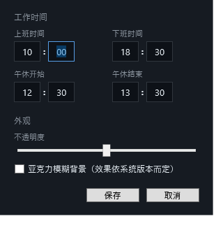

# Timline ⏰

> 常驻 Windows 桌面的半透明下班倒计时小卡片——每天盯着它，看"痛苦"一点点变绿。

<p align="center">
  
</p>

基于 **.NET 10 / WPF**，单进程、无后台服务、零第三方 UI 依赖（仅托盘库），发布后是一个免安装的单文件 exe。

## ✨ 功能

**倒计时与状态**

- 🕐 **下班倒计时**：按配置的上下班时间秒级刷新，附当日工作进度
- 📊 **剩余工时条（减少模式）**：上班满条、随时间从左向右缩短，红→黄→绿渐变，红色端先被"消耗"——剩下越少越开心
- 🎨 **主题色联动**：时间文字颜色与进度条同步（早红晚绿）并带霓虹发光；百分比不足 1% 时显示小数
- 🍜 **午休庆祝态**：午休时段卡片居中显示"午休剩余 X 分钟"，中文白色发光、数字按午休剩余比例变色（快结束时变红提示"该干活了"）
- 🎉 **下班庆祝态**：到点后居中显示"🎉 下班啦"，隐藏进度条与百分比

**节假日与通知**

- 📅 **法定节假日与调休**：自动判断周末/法定假日/调休补班，"本周剩余工时"按净工时（扣除午休）精确换算
- 🔔 **状态通知**：上班、午休开始、午休结束、下班四个节点弹系统通知（托盘气泡，Win10/11 渲染为原生 toast），每次状态只提醒一次

**桌面体验**

- 🪟 半透明无边框圆角卡片，可拖动、位置记忆，透明度 25%~100% 可调
- 📐 卡片大小可拖拽调节：拖边缘/角落等比缩放（右键菜单可一键恢复默认），大小自动记忆——小屏笔记本也能缩到合适尺寸
- 🧊 可选亚克力模糊背景（DWM），文字带护眼光晕，低透明度下依然清晰
- 🏖 自定义假期：每周休息日自由勾选（单休/双休/自选周几）、可关闭法定数据、按日期添加自定义假期/调休上班日，"距假期 N 天"倒计时同步生效
- 🖱 托盘图标：双击开设置；右键菜单：置顶 / 开机自启 / 透明度 / 模糊 / 设置 / 退出
- 🔁 单实例保护，重复启动自动退出

<p align="center">
  
  
  
</p>

## 🚀 快速开始

### 下载安装（推荐）

到 [Releases](https://github.com/Worleybel/Timeline/releases/latest) 下载 `Timline-x.x.x-win-x64.exe`（自包含单文件，内置 .NET 10 运行时，免安装），双击即用，系统要求 **Windows 10 1809+ / Windows 11**。

### 从源码构建

构建需 [.NET 10 SDK](https://dotnet.microsoft.com/download/dotnet/10.0)：

```bash
git clone https://github.com/Worleybel/Timeline.git
cd Timeline

# 运行
dotnet run --project Timline

# 构建
dotnet build Timline.slnx

# 发布为自包含单文件 exe（目标机器无需安装 .NET）
dotnet publish Timline -c Release -r win-x64 -p:PublishSingleFile=true --self-contained
```

也可以直接用 Visual Studio 2022/2026 打开 `Timline.slnx`（F5 即跑）。

## ⚙️ 配置

所有配置持久化在 `%APPDATA%\Timline\config.json`，推荐通过"设置"窗口修改（时间为 `[HH]:[mm]` 分段输入：仅数字、输满两位自动跳格、失焦补零）：

| 字段 | 默认 | 说明 |
|---|---|---|
| `WorkStart` / `WorkEnd` | 09:00 / 18:00 | 上下班时间（大倒计时以下班时刻为准） |
| `LunchStart` / `LunchEnd` | 12:00 / 13:00 | 午休区间，净工时计算时扣除与工作时段的重叠部分 |
| `WeeklyRestDays` | `["Saturday", "Sunday"]` | 每周休息日（Monday…Sunday），单休/双休/自选周几 |
| `IgnoreStatutoryHolidays` | `false` | 不跟随国家法定节假日数据（假期全靠每周规律 + 自定义日期） |
| `CustomDays` | `[]` | 按日期自定义的假期/上班日（`[{ "Name": "…", "Date": "2026-01-28", "IsOffDay": true }]`），优先于法定数据 |
| `OpacityLevel` | 0.85 | 卡片背景不透明度（只影响背景，不影响文字） |
| `EnableBlur` | `false` | 亚克力模糊背景 |
| `WindowX` / `WindowY` | — | 窗口位置（拖动自动记忆） |
| `WindowWidth` / `WindowHeight` | 252 × 154 | 卡片大小（拖边缘/角落自动记忆，范围 170×104 ~ 560×342，高度按 252:154 比例锁定） |

## 📅 节假日数据

数据来自开源项目 [NateScarlet/holiday-cn](https://github.com/NateScarlet/holiday-cn)（国务院每年公布的法定假日与调休安排）：

- 首次启动后台拉取**今年与明年**两份数据，缓存在 `%APPDATA%\Timline\holidays\`
- 每 7 天自动刷新，依次尝试 jsdelivr 双镜像与 GitHub 原始地址
- 离线时使用本地缓存；完全无数据时退化为"周一至周五"判断

## 🏗 项目结构

```
Timline/
├── Models/           AppConfig（配置）、HolidayDay（节假日条目）
├── Services/
│   ├── CountdownCalculator.cs   状态机：距上班/距下班/午休/已下班/休息 + 工时计算
│   ├── HolidayService.cs        holiday-cn 拉取、镜像回退、本地缓存
│   ├── ConfigService.cs         配置读写
│   └── AutoStartService.cs      开机自启（HKCU Run，无需管理员）
├── Interop/
│   └── DwmInterop.cs            Win32：系统圆角 + 亚克力模糊
├── Windows/
│   ├── SettingsWindow.*         设置窗口
│   └── TimePickerRow.*          [HH]:[mm] 分段时间输入控件
├── Assets/app.ico             应用图标
└── MainWindow.*               主控件：卡片 UI、托盘、右键菜单、通知
tools/                          图标生成、开发辅助脚本
docs/                           截图
```

## 🔧 开发辅助

- `Timline.exe --screenshot [路径]` — 渲染主控件 PNG 后自动退出（任意状态下验证 UI）
- `Timline.exe --screenshot-settings [路径]` — 同上，目标是设置窗口
- `tools/make-icon.ps1` — 重新生成应用图标
- `tools/write-rapid-test-config.ps1` + `tools/capture-corner.ps1` — 造出分钟级快速状态跳变并抓屏，用于验证通知
- `tools/release.ps1` — 一键发版：自动递增版本号 → 打自包含单文件 exe → 创建 GitHub Release 并上传附件（变更日志自动取上一个 tag 以来的提交）。用法：

  ```powershell
  powershell -File tools\release.ps1                # 版本号自动递增 patch
  powershell -File tools\release.ps1 -Version 2.0.0 # 指定版本号
  powershell -File tools\release.ps1 -DryRun        # 只看计划，不打包不上传
  ```


## 🙏 致谢

- [holiday-cn](https://github.com/NateScarlet/holiday-cn) — 中国法定节假日数据
- [Hardcodet.NotifyIcon.Wpf](https://github.com/hardcodet/wpf-notifyicon) — 托盘图标与气泡通知

## 📄 许可证

本项目基于 [MIT License](LICENSE) 开源。
